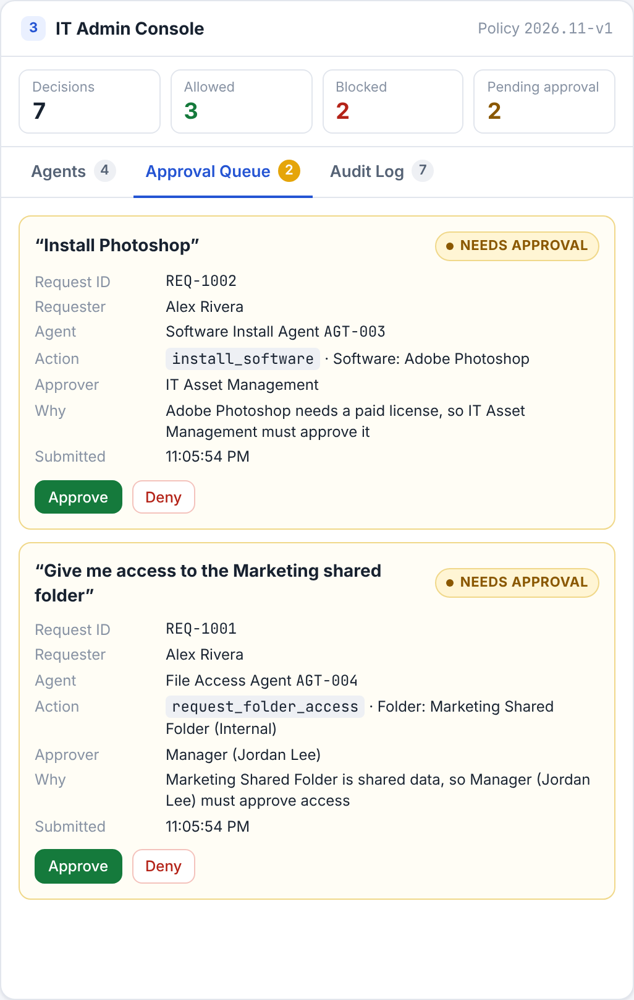

# Agent Access Manager

> A control layer that decides what AI agents are allowed to do. It covers identity, signed short-lived tokens, least-privilege permissions, human approval and audit logging, with a Python backend that enforces every decision server-side.

**Status:** Prototype v2 · Portfolio project · Company systems are simulated

**Live demo:** https://aishramku.github.io/agent-access-manager/

---

## The problem

Companies are giving AI agents access to calendars, identity systems, laptops and file shares. But **AI agents don't police themselves.** An agent will try to do whatever a user asks, including things it should never be allowed to do:

- deleting data when it was only meant to edit it
- resetting *someone else's* password
- installing unapproved or unlicensed software
- opening folders that contain sensitive HR data

IT teams need a layer that sits **between the agent and the systems it touches**, and checks every request before anything happens. That layer applies the same controls used for human users and service accounts: verified identity, scoped permissions, expiring credentials, approvals for risky actions, and a full audit trail.

## How a request flows

```
Browser (chat + admin UI)
        │  plain-language request
        ▼
FastAPI backend ──────────────────────────────────────────────────────────────
  1. Router         keyword match picks the agent and the action
  2. Identity       the agent presents its JWT → signature, issuer, audience,
                    subject, revocation list and expiry are verified
  3. Policy check   permission granted? acting only for the requester?
                    software / folder rules (allow · approval · deny)
  4. Decision       ALLOWED → simulated system runs the action
                    BLOCKED → nothing runs
                    NEEDS APPROVAL → queued for a person
  5. Audit log      every outcome written to the database
──────────────────────────────────────────────────────────────────────────────
        ▼
SQLite: sandboxes · tokens + revocation list · audit log · approval queue
```

Each decision is shown step by step in the **Decision Trace** panel and recorded in the **Audit Log**.

## Features

**Chat (left panel)**
- Type a request in plain English, or click a **Try this** sample
- Keyword routing sends it to the right agent; requests no agent can handle are blocked and logged
- Each reply carries a colored decision badge: 🟢 Allowed · 🔴 Blocked · 🟡 Needs approval

**Decision Trace (middle panel)**
- Four steps: request understood and routed → identity + token check → permission check against the policy → final result with a plain-language reason
- A live mini calendar that updates when the Calendar Agent moves or cancels a meeting

**IT Admin Console (right panel)**
- **Agents:** ID, owner, permission on/off toggles, token status, a live 1-hour expiry countdown, and **Revoke**, **Rotate** and **Simulate expiry**. A toggle change takes effect on the very next request.
- **Approval Queue:** pending requests with requester, agent, action and approver, plus **Approve** and **Deny**. An approved request is re-checked before it runs, so a revoked token still blocks it.
- **Audit Log:** time, agent, action, request, result and reason, newest first, filterable and exportable to CSV. Admin actions are logged too.

**Backend (v2)**
- **Server-side enforcement:** the browser only sends text and clicks; the server makes every decision
- **Real signed JWTs** for each agent (HS256), verified on every request: signature, issuer, audience, subject, revocation list and expiry
- **Credential store:** tokens never leave the server; the browser only sees a masked preview
- **Revocation and rotation:** a rotated token is revoked so it can never be reused
- **SQLite storage** for the audit log (append-only), approval queue, tokens and pending verifications
- **Isolated demo sandboxes:** each visitor gets their own policy, tokens and calendar, so one person's demo never affects another's
- **Input validation** on every endpoint, a constant-time comparison for verification codes, and codes are never stored or logged
- **Interactive API docs** at `/docs`
- **25 automated tests** covering every scenario plus token tampering and cross-agent token reuse

The page detects the backend automatically. With no backend reachable, it falls back to running the same rules in the browser, and a badge in the header shows which mode is active.

### The four agents

| Agent | Owner | Permissions | Try it |
|---|---|---|---|
| **Calendar Agent** `AGT-001` | IT Operations | `read_calendar`, `update_calendar` (no `delete_calendar`) | "Move my 2pm meeting to 4pm" → Allowed · "Cancel all my meetings tomorrow" → Blocked |
| **Password Reset Agent** `AGT-002` | Service Desk | `reset_own_password` (verification required) | "Reset my password" → code `123456` → Allowed (wrong code → Blocked) · "Reset my manager's password" → Blocked |
| **Software Install Agent** `AGT-003` | Endpoint Management | `install_software` · approved: Zoom, Slack, Chrome, Microsoft Teams · licensed: Adobe Photoshop, Tableau | "Install Zoom" → Allowed · "Install Photoshop" → Needs approval · "Install a free VPN" → Blocked |
| **File Access Agent** `AGT-004` | Data Governance | `read_own_files`, `request_folder_access` | "Open my project files" → Allowed · "Marketing shared folder" → Needs approval · "HR salary folder" → Blocked |

### Things to try
1. Send **"Move my 2pm meeting to 4pm"** and watch the calendar update.
2. In **Agents**, turn off `update_calendar`, then send **"Move my 4pm meeting to 2pm"**. It is now blocked.
3. **Revoke** the Software Install Agent's token, then send **"Install Slack"**. The reason is "Token revoked". **Rotate** to restore access.
4. Send **"Install Photoshop"**, then approve it in the **Approval Queue**.
5. Filter the **Audit Log** by *Blocked* and export it to CSV.

## How each piece maps to real IT tools

| Concept in this project | What it does here | Real-world equivalent |
|---|---|---|
| **Agent identity** (`AGT-00x`, owner) | Every agent is a registered identity with an accountable owning team | **Microsoft Entra ID** workload identities / app registrations, **Okta** service apps |
| **Least privilege** (policy, permission toggles) | Each agent gets only the permissions its job needs; anything else is denied | **Microsoft Entra ID** app roles, **Okta** OAuth scopes, **AWS IAM** policies |
| **Short-lived signed tokens** (JWT, revoke, rotate) | Access expires automatically and can be cut off instantly | **Entra ID** / **Okta** access tokens and revocation, **Azure Key Vault** secret rotation, AWS STS |
| **Credential store** | Tokens are held server-side and never exposed to the browser | **Azure Key Vault**, AWS Secrets Manager |
| **Human approval** (Approval Queue) | Risky actions wait for a named approver | **Entra ID Privileged Identity Management (PIM)**, **Okta Identity Governance** access requests |
| **Audit logging** (append-only log, CSV export) | Every decision is traceable: who, what, result, why | **Splunk**, **Microsoft Sentinel** (SIEM) |
| **Act only for the requester** | Agents can't act on behalf of other users | On-behalf-of (OBO) token flows in **Entra ID** / **Okta** |

## Project structure

```
index.html              the web app (works with or without the backend)
backend/
  app/
    policy.json         every rule: agents, permissions, software lists, folder rules
    checker.py          the permission checker (pure function, no I/O)
    router.py           keyword routing from text to agent + action
    tokens.py           JWT issue / verify / revoke / rotate
    service.py          request flows: route → verify → check → act → log
    actions.py          simulated company systems (calendar, installs, folders)
    db.py               SQLite schema and connections
    main.py             FastAPI routes
  tests/test_api.py     25 tests
render.yaml             one-click deploy of the backend on Render
docs/                   screenshots
```

## How to run

### Option 1: just the web page
Open **`index.html`** in a browser. Everything runs in the page (browser demo mode).

### Option 2: with the backend (recommended)
Requires Python 3.10+.

```bash
cd backend
python -m venv .venv
source .venv/bin/activate          # Windows: .venv\Scripts\activate
pip install -r requirements.txt
uvicorn app.main:app --reload
```

Then open **http://127.0.0.1:8000**. The header badge shows **Live backend**. API docs are at **http://127.0.0.1:8000/docs**.

Run the tests:

```bash
pip install -r requirements-dev.txt
pytest
```

### Configuration

| Variable | Purpose | Default |
|---|---|---|
| `AAM_JWT_SECRET` | Key used to sign agent tokens. Set a long random value in production. | Random per start (tokens reset on restart) |
| `AAM_ALLOWED_ORIGINS` | Comma-separated sites allowed to call the API from a browser | `*` |
| `AAM_DB_PATH` | Location of the SQLite database | `backend/aam.db` |

### Deploy

- **Front end:** GitHub Pages (Settings → Pages → `main` / root).
- **Backend:** Render's free plan. In Render choose **New + → Blueprint**, pick this repository, and it reads `render.yaml`. Then set `BACKEND_URL` near the top of the script in `index.html` to your Render URL and push. Free instances sleep when idle, so the first request can take up to a minute; the page shows "Connecting to backend…" meanwhile. Data on the free plan resets when the service restarts.

## API

| Method | Path | What it does |
|---|---|---|
| `GET` | `/api/health` | Health check |
| `POST` | `/api/sessions` | Create an isolated demo sandbox; returns its id and state |
| `GET` | `/api/state` | Agents, token status, approvals, audit log and calendar |
| `POST` | `/api/requests` | Submit a plain-language request |
| `POST` | `/api/verify` | Submit a verification code for a pending password reset |
| `POST` | `/api/approvals/{id}/approve` · `/deny` | Decide a queued request |
| `PUT` | `/api/agents/{id}/permissions/{permission}` | Turn a permission on or off |
| `POST` | `/api/agents/{id}/token/revoke` · `/rotate` · `/expire` | Manage an agent's token |

Every call except health and session creation needs the `X-Session-Id` header.

## Screenshots

| Main dashboard | Decision trace | Admin console |
|---|---|---|
|  |  |  |

## Roadmap

- **v1:** single-page prototype; all logic in the browser
- **v2 (this version):** FastAPI backend, signed JWTs with revocation, SQLite audit log and approval queue, server-side enforcement, tests
- **v3 (next):** a real AI agent. Replace keyword routing with Claude tool use, so the model chooses which tool to call and this gateway checks every tool call before it runs, including blocking prompt-injection attempts at the action level.
- **Later:** SSO login with separate employee and admin roles, connecting to Microsoft Graph for a real calendar, and exporting the audit log to a SIEM

## Tech

**Front end:** HTML · CSS · JavaScript (no framework) · GitHub Pages
**Backend:** Python · FastAPI · PyJWT · SQLite · pytest · Render

## Disclaimer

This is an educational project. All users, agents, folders and company systems are fictional, and the demo verification code is public. Product names are used only to describe the equivalent real-world tools.
