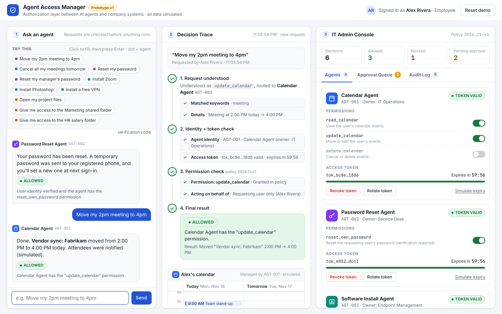
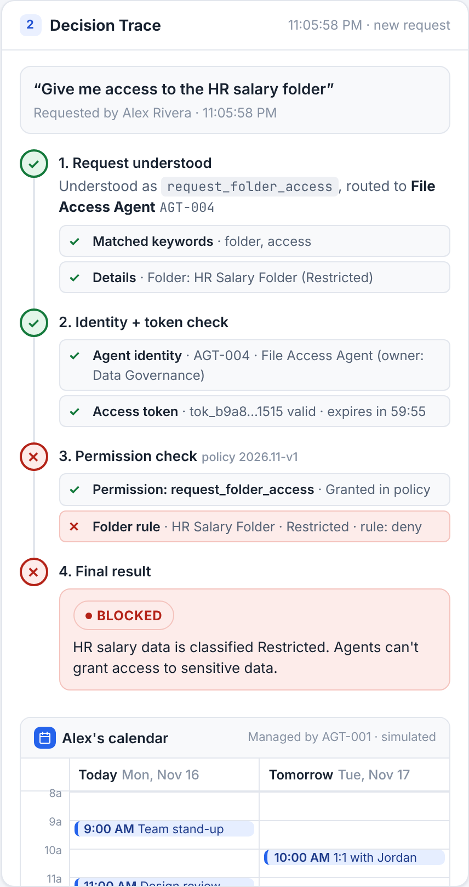

# Agent Access Manager

> A browser prototype of the control layer that decides what AI agents are allowed to do: identity, short-lived tokens, least-privilege permissions, human approval and audit logging.

**Status:** Prototype v1 · Portfolio project · All data is simulated (no real backend, APIs or accounts)

**Live demo:** `https://<your-username>.github.io/<repo-name>/`

---

## The problem

Companies are giving AI agents access to calendars, identity systems, laptops and file shares. But **AI agents don't police themselves.** An agent will try to do whatever a user asks, including things it should never be allowed to do:

- deleting data when it was only meant to edit it
- resetting *someone else's* password
- installing unapproved or unlicensed software
- opening folders that contain sensitive HR data

IT teams need a layer that sits **between the agent and the systems it touches**, and checks every request before anything happens. That layer applies the same controls used for human users and service accounts: verified identity, scoped permissions, expiring credentials, approvals for risky actions, and a full audit trail.

Agent Access Manager is a working, clickable model of that layer.

## How a request flows

```
User request ─► Router ─► Authentication layer ─────────────► Decision ─► Audit log
 (chat box)     (keyword    1. Identity: who is this agent?    ALLOWED
                 match)     2. Token: valid / expired /        BLOCKED
                               revoked?                        NEEDS APPROVAL
                            3. Permission: does the policy
                               allow this action on this
                               resource for this user?
```

Each decision is shown step by step in the **Decision Trace** panel and recorded in the **Audit Log**.

## Features

**Chat (left panel)**
- Type a request in plain English, or click a **Try this** sample
- Keyword routing sends it to the right agent; requests no agent can handle are blocked and logged
- Each reply carries a colored decision badge: 🟢 Allowed · 🔴 Blocked · 🟡 Needs approval

**Decision Trace (middle panel)**
- Four steps: request understood and routed → identity + token check → permission check against the policy → final result with a plain-language reason
- A live mini calendar that updates when the Calendar Agent moves or cancels a meeting

**IT Admin Console (right panel)**
- **Agents:** ID, owner, permission on/off toggles, token status, a live 1-hour expiry countdown, and **Revoke Token**, **Rotate Token** and **Simulate expiry**. A toggle change takes effect on the very next request. The live policy JSON can be viewed here.
- **Approval Queue:** pending requests with requester, agent, action and approver, plus **Approve** and **Deny** (with a count badge). An approved request is re-checked before it runs, so a revoked token still blocks it.
- **Audit Log:** time, agent ID, action, request, result and reason, newest first. Filter by All, Allowed, Blocked or Needs approval, and export to CSV. Admin actions (permission changes, token revoke and rotate) are logged too.

### The four agents

| Agent | Owner | Permissions | Try it |
|---|---|---|---|
| **Calendar Agent** `AGT-001` | IT Operations | `read_calendar`, `update_calendar` (no `delete_calendar`) | "Move my 2pm meeting to 4pm" → Allowed · "Cancel all my meetings tomorrow" → Blocked |
| **Password Reset Agent** `AGT-002` | Service Desk | `reset_own_password` (verification required) | "Reset my password" → code `123456` → Allowed (wrong code → Blocked) · "Reset my manager's password" → Blocked |
| **Software Install Agent** `AGT-003` | Endpoint Management | `install_software` · approved: Zoom, Slack, Chrome, Microsoft Teams · licensed: Adobe Photoshop, Tableau | "Install Zoom" → Allowed · "Install Photoshop" → Needs approval · "Install a free VPN" → Blocked |
| **File Access Agent** `AGT-004` | Data Governance | `read_own_files`, `request_folder_access` | "Open my project files" → Allowed · "Marketing shared folder" → Needs approval · "HR salary folder" → Blocked |

### Things to try
1. Send **"Move my 2pm meeting to 4pm"** and watch the calendar update.
2. In **Agents**, turn off `update_calendar`, then send **"Move my 4pm meeting to 2pm"**. It is now blocked.
3. **Revoke** the Software Install Agent's token, then send **"Install Slack"**. The reason is "Token revoked". **Rotate** to restore access.
4. Send **"Install Photoshop"**, then approve it in the **Approval Queue**.
5. Filter the **Audit Log** by *Blocked* and export it to CSV.

## Design: policy-driven, backend-ready

- **One policy object.** All agent permissions, the approved and licensed software lists, folder rules (`allow` / `approval` / `deny`) and routing keywords are in a single `POLICY` JSON object at the top of the script. Change the policy and the behavior changes. No rules are hardcoded in the decision logic.
- **Isolated checker.** `checkAccess(request, context)` is a pure function: it takes a request plus `{ policy, tokens, now }` and returns `{ decision, reason, checks }`. It doesn't touch the DOM or global state, so it can move to a server unchanged.
- **Default deny.** Unknown software, unregistered folders and unrouted requests are all blocked. When several folder rules match, the most restrictive one wins.

## How each piece maps to real IT tools

| Concept in this prototype | What it does here | Real-world equivalent |
|---|---|---|
| **Agent identity** (`AGT-00x`, owner) | Every agent is a registered identity with an accountable owning team | **Microsoft Entra ID** workload identities / app registrations, **Okta** service apps |
| **Least privilege** (permission toggles, policy JSON) | Each agent gets only the permissions its job needs | **Microsoft Entra ID** app roles, **Okta** OAuth scopes, **AWS IAM** policies |
| **Short-lived tokens** (1-hour expiry, revoke, rotate) | Access expires automatically and can be cut off instantly | **Entra ID** / **Okta** access tokens and revocation, **Azure Key Vault** secret and key rotation, AWS STS |
| **Human approval** (Approval Queue) | Risky actions wait for a named approver | **Entra ID Privileged Identity Management (PIM)**, **Okta Identity Governance** access requests |
| **Audit logging** (Audit Log, CSV export) | Every decision is traceable: who, what, result, why | **Splunk**, **Microsoft Sentinel** (SIEM) |
| **Act only for the requester** | Agents can't act on behalf of other users | On-behalf-of (OBO) token flows in **Entra ID** / **Okta** |

## How to run

No build step and no dependencies.

1. Download or clone this repository.
2. Open **`index.html`** in any modern browser.

**Host on GitHub Pages:** push the repo to GitHub → **Settings → Pages** → Source: *Deploy from a branch* → Branch: `main` / root → Save. The app will be live at `https://<your-username>.github.io/<repo-name>/`.

Click **Reset demo** in the header to start over with fresh tokens, the original policy and the original calendar.

## Screenshots

<!-- Replace these with your own captures -->
| Main dashboard | Decision trace | Admin console |
|---|---|---|
|  |  |  |

## Roadmap

**v1 (this version):** a single HTML file with plain JavaScript and CSS. All data is simulated in the browser.

**v2 (planned):**
- **Python backend** with Flask or FastAPI
- **Database** (e.g. PostgreSQL or SQLite) for policies, agents, approvals and the audit log
- **Real JWT tokens**, signed and short-lived, with server-side revocation
- **Server-side permission checks**: `checkAccess()` moves to the API, and the browser only displays decisions
- Later ideas: SSO login via OIDC, policy versioning with change history, SIEM export to Splunk or Sentinel

## Tech

HTML · CSS · vanilla JavaScript · no frameworks · no build tools · fonts from Google Fonts (Inter, JetBrains Mono)

## Disclaimer

This is an educational prototype. All users, agents, tokens, folders and systems are fictional, and no real authentication happens. Product names are used only to describe the equivalent real-world tools.
